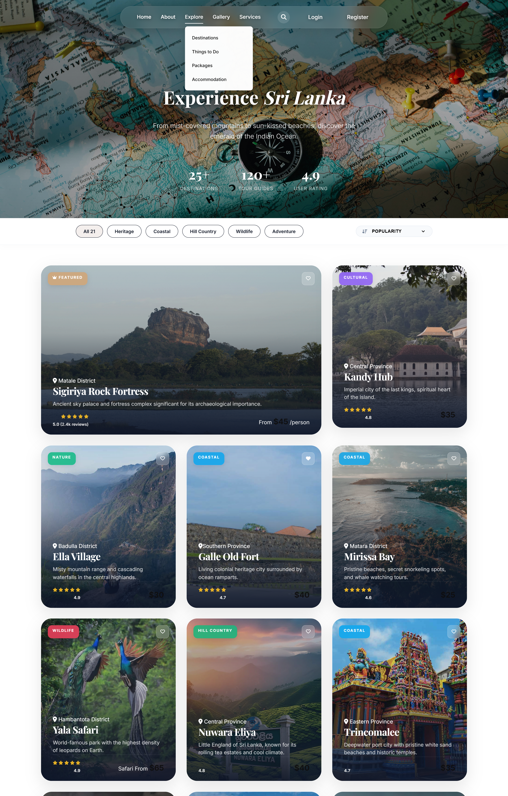
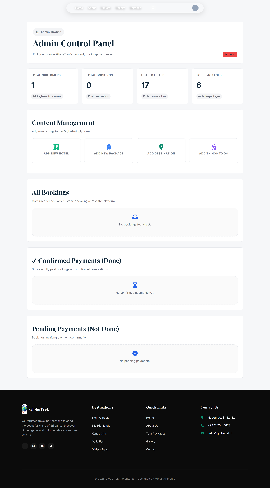

# GlobeTrekAdventures

# 🌍 GlobeTrek Adventures

[](https://www.php.net/)
[](https://www.mysql.com/)
[](https://developer.mozilla.org/en-US/docs/Web/HTML)
[](https://developer.mozilla.org/en-US/docs/Web/CSS)
[](https://developer.mozilla.org/en-US/docs/Web/JavaScript)
[](https://www.apachefriends.org/)

**GlobeTrek Adventures** is a full-stack travel and tourism management web application designed to showcase Sri Lanka's top travel destinations, curated tour packages, hotels, and adventure activities. Built with **PHP (PDO)**, **MySQL**, **JavaScript**, **HTML5**, and **CSS3**, the platform provides seamless booking experiences for travelers and powerful management dashboards for staff and administrators.

---

## 📑 Table of Contents

- [Key Features](#-key-features)
- [Screenshots](#-screenshots)
- [Tech Stack](#-tech-stack)
- [Project File Structure](#-project-file-structure)
- [Installation & Setup](#-installation--setup)
- [Database Configuration](#-database-configuration)
- [Default User Credentials](#-default-user-credentials)
- [User Roles & Permissions](#-user-roles--permissions)
- [Contributing](#-contributing)
- [License](#-license)

---

## ✨ Key Features

- **🏝️ Destination Explorer**: Detailed travel guides for major Sri Lankan destinations including Sigiriya, Ella, Kandy, Galle, Yala, Mirissa, Nuwara Eliya, and more.
- **🎒 Curated Tour Packages**: Browse, filter, and book specialized travel packages (Cultural Triangle Explorer, Southern Shores Escape, Wild Safari, Hill Country Tea Trail, etc.).
- **🏨 Accommodation & Hotel Booking**: Explore boutique, luxury, and eco-lodges with dynamic amenities, ratings, and instant reservation processing.
- **🧗 Things to Do & Activities**: Dedicated guides for adventure sports, canyoning, surfing in Arugam Bay, hot air ballooning, and hiking trails.
- **👥 Multi-Role Authentication**:
  - Secure Registration & Login with password hashing (`password_hash` / `password_verify`).
  - Password Reset with token expiration (`password_resets` table).
  - Role-based access control for **Customer**, **Staff**, and **Administrator**.
- **📊 Admin & Staff Dashboards**:
  - Real-time booking management (status updates: pending, confirmed, cancelled).
  - Payment tracking and financial records.
  - CRUD operations for destinations, hotels, activities, and packages.
- **📱 Responsive & Interactive UI**: Modern CSS grid/flexbox layouts, hero video banners, dynamic search/filters, and interactive booking modal forms.

---

## 📸 Screenshots

| Home Page | Destination Explorer |
| :---: | :---: |
|  |  |

| Booking Portal | Admin Dashboard |
| :---: | :---: |
|  |  |

---

## 🛠️ Tech Stack

- **Backend**: PHP 7.4+ / 8.x (PDO with prepared statements for SQL injection prevention)
- **Frontend**: HTML5, CSS3 (Modular stylesheets & responsive design), JavaScript (Vanilla ES6+)
- **Database**: MySQL / MariaDB (Relational schema with foreign keys and cascade actions)
- **Server Environment**: Apache / XAMPP / WampServer / LAMP stack

---

## 📁 Project File Structure

```text
globeTrekadventures/
├── 404.html                               # Custom 404 error page
├── about.html                             # About Us page
├── booking.html                           # Booking portal UI
├── contact.html                           # Contact form page
├── forgot-password.html                   # Password reset request form
├── gallery.html                           # Photo gallery showcase
├── globetrek_db.sql                       # Complete MySQL database dump
├── guide.html                             # Sri Lanka travel guide
├── index.html                             # Landing page redirect/entry
├── index.php                              # Dynamic homepage
├── login.html                             # Authentication login page
├── register.html                          # User registration page
├── reset-password.html                    # Password update page
├── terms.html                             # Terms and conditions
├── transport.html                         # Transport & rental services
│
├── admin/                                 # Administrator portal
│   ├── dashboard.php                      # Admin control dashboard
│   ├── payments_bookings.php              # Payment & booking management
│   └── staff_dashboard.php                # Staff management interface
│
├── api/                                   # REST / JSON API endpoints
│   ├── get_hotels.php                     # Hotel data provider
│   ├── process_contact.php                # Contact form submission handler
│   ├── process_newsletter.php             # Newsletter subscription handler
│   ├── request_password_reset.php         # Password reset token issuer
│   └── reset_password.php                 # Password update API
│
├── css/                                   # Stylesheets
│   ├── activity-heroes.css                # Hero section styling for activities
│   ├── admin-forms.css                    # Admin CRUD form styles
│   ├── auth-redirect.css                  # Auth redirection screens
│   ├── auth.css                           # Login / registration styles
│   ├── booking.css                        # Booking engine styles
│   ├── contact.css                        # Contact page styling
│   ├── dashboard.css                      # Admin & user dashboard styling
│   ├── destinations.css                   # Destination grid & card styles
│   ├── hotels.css                         # Hotel listing and detail styles
│   ├── layout.css                         # Core grid and container layouts
│   ├── navigation.css                     # Header, navbar, and dropdowns
│   ├── pages.css                          # General static pages styling
│   ├── payments.css                       # Payment tables and cards
│   ├── responsive.css                     # Media queries for tablet & mobile
│   ├── services.css                       # Service offerings layout
│   ├── style.css                          # Global primary styles
│   └── things-to-do.css                   # Activity list styles
│
├── destinations/                          # Destination guide pages
│   ├── anuradhapura/                      # Ancient city guides
│   ├── arugambay/                         # Surf haven guides
│   ├── badulla/                           # Hill country guides
│   ├── bentota/                           # Beach & water sports
│   ├── colombo/                           # Commercial capital guides
│   ├── dambulla/                          # Cave temple guides
│   ├── ella/                              # Mountain & hiking guides
│   ├── galle/                             # Historic fort guides
│   ├── haputale/                          # Tea plantation guides
│   ├── hikkaduwa/                         # Coral reef & diving guides
│   ├── kalpitiya/                         # Kitesurfing & dolphin guides
│   ├── kandy/                             # Sacred temple guides
│   ├── mirissa/                           # Whale watching guides
│   ├── negambo/                           # Coastal lagoon guides
│   ├── nuwaraeliya/                       # Little England guides
│   ├── pasikuda/                          # East coast beach guides
│   ├── polonnaruwa/                       # Royal kingdom guides
│   ├── ratnapura/                         # Gem city guides
│   ├── sigiriya/                          # Lion rock fortress guides
│   ├── thrincomalee/                      # Natural harbour & temple guides
│   ├── udawalawe/                         # Elephant transit camp guides
│   ├── yala/                              # Leopard safari guides
│   └── destinations.html                  # Destination master listing
│
├── images/                                # Project image assets & media
├── includes/                              # Reusable PHP templates
│   ├── footer.php                         # Common page footer
│   ├── header.php                         # Common HTML head and scripts
│   ├── navbar.php                         # Dynamic navigation bar
│   └── newsletter.php                     # Newsletter subscription modal
│
├── js/                                    # Client-side JavaScript
│   ├── activities.js                      # Activity filters & cards
│   ├── admin.js                           # Admin panel interactions & AJAX
│   ├── auth.js                            # Form validation for login/register
│   ├── booking.js                         # Dynamic booking form calculation
│   ├── destinations.js                    # Destination search & filter logic
│   ├── gallery.js                         # Lightbox & gallery controls
│   ├── guide.js                           # Interactive guide elements
│   ├── hotel-details.js                   # Hotel modal & review handler
│   ├── hotels.js                          # Hotel filters & category toggle
│   ├── packages.js                        # Tour package cards & filters
│   ├── payments.js                        # Payment processing & simulation
│   ├── redirect.js                        # Client-side navigation helper
│   ├── script.js                          # Main application scripts
│   ├── things-to-do.js                    # Activities filtering & interaction
│   └── ui.js                              # UI helpers (menus, modals, toasts)
│
├── packages/                              # Tour package details
│   ├── cultural-triangle.html             # Cultural Triangle Explorer
│   ├── east-coast.html                    # East Coast Lagoon Escape
│   ├── hill-country.html                  # Hill Country Tea Trail
│   ├── rainforest.html                    # Rainforest & River Adventure
│   ├── southern-shores.html               # Southern Shores Escape
│   └── wildlife-safari.html               # Wild Sri Lanka Safari
│
├── php/                                   # Backend controllers & scripts
│   ├── about.php                          # About controller
│   ├── accommodation.php                  # Accommodation view controller
│   ├── admin_add_activity.php             # Add new activity endpoint
│   ├── admin_add_destination.php          # Add new destination endpoint
│   ├── admin_add_hotel.php                # Add new hotel endpoint
│   ├── admin_add_package.php              # Add new tour package endpoint
│   ├── admin_dashboard.php                # Admin dashboard controller
│   ├── api_stats.php                      # Admin metrics & stats API
│   ├── auth.php                           # Session & auth middleware
│   ├── booking.php                        # Booking submission & processing
│   ├── check_users.php                    # User availability helper
│   ├── config.php                         # PDO Database connection & constants
│   ├── contact.php                        # Contact handler
│   ├── create_customer.php                # Customer generation utility
│   ├── create_staff.php                   # Staff generation utility
│   ├── dashboard.php                      # Customer dashboard controller
│   ├── forgot-password.php                # Password reset handler
│   ├── get_auth_status.php                # Current session state API
│   ├── hotel.php                          # Hotel details controller
│   ├── login.php                          # Login validation & session start
│   ├── logout.php                         # Session destruction & sign out
│   ├── my_bookings.php                    # Customer bookings view
│   ├── packages.php                       # Packages listing controller
│   ├── payments_bookings.php              # Payments management controller
│   ├── process_hotel_booking.php          # Hotel booking handler
│   ├── register.php                       # User registration controller
│   ├── reset-password.php                 # Password update processor
│   ├── reset_admin.php                    # Admin credential reset utility
│   ├── search.php                         # Global search controller
│   ├── staff_dashboard.php                # Staff dashboard controller
│   └── test_db.php                        # Database connectivity test
│
├── screenshots/                           # Application preview images
│   ├── localhost_globeTrekadventures_admin_dashboard.php.png
│   ├── localhost_globeTrekadventures_destinations_destinations.html.png
│   ├── localhost_globeTrekadventures_index.php.png
│   └── localhost_globeTrekadventures_php_booking.php.png
│
├── thingstodo/                            # Things-to-do & adventure pages
│   ├── boat-safari-sri-lanka.html         # Boat safari details
│   ├── bungee-jumping-sri-lanka.html      # Bungee jumping details
│   ├── canyoning-abseiling-kitulgala.html # Kitulgala canyoning
│   ├── cultural-events-local-experiences.html
│   ├── flying-ravana-zipline-ella.html    # Ella zipline guide
│   ├── hot-air-balloon-sigiriya-dambulla.html
│   ├── mirissa-oceanfront-dining.html     # Mirissa dining experience
│   ├── nil-diya-pokuna-blue-cave.html     # Underground cave expedition
│   ├── sinharaja-rainforest-trek.html     # Rainforest trek guide
│   ├── southern-coast-beach-and-seafood.html
│   ├── surfing-arugam-bay.html            # Surfing guide
│   ├── things-to-do.html                  # Activities master listing
│   ├── unawatuna-beach-relaxation.html    # Beach guide
│   ├── white-water-rafting-kitulgala.html # White water rafting
│   └── worlds-end-hike.html               # Horton Plains hike guide
│
└── video/                                 # Video assets
    └── homesrilanka.mp4                   # Hero banner video
```

---

## 🚀 Installation & Setup

Follow these steps to set up and run the application locally using **XAMPP**:

### Prerequisites
- [XAMPP](https://www.apachefriends.org/index.html) (PHP 7.4 or higher, Apache, MySQL)
- Web Browser (Chrome, Firefox, Edge, etc.)
- Git installed on your machine

### 1. Clone the Repository
Clone this repository directly into your local web server's root folder (`htdocs` for XAMPP):

```bash
# On Windows (Default XAMPP location):
cd C:\xampp\htdocs

# Clone the repository
git clone https://github.com/YOUR_USERNAME/GlobeTrekAdventures.git
```

### 2. Start XAMPP Services
1. Open the **XAMPP Control Panel**.
2. Click **Start** for **Apache**.
3. Click **Start** for **MySQL**.

### 3. Import Database Schema
1. Open your browser and navigate to [http://localhost/phpmyadmin](http://localhost/phpmyadmin).
2. Click **New** in the left sidebar to create a new database.
3. Set the database name to:
   ```text
   globetrek_db
   ```
4. Choose `utf8mb4_general_ci` as collation, then click **Create**.
5. Select the newly created `globetrek_db` database, go to the **Import** tab.
6. Click **Choose File** and select:
   ```text
   globetrek_db.sql
   ```
7. Click **Import** (or **Go**) at the bottom to execute the SQL queries.

### 4. Verify Database Configuration
The database connection settings are located in:
`php/config.php`

Default settings match standard XAMPP configuration:
```php
define('DB_HOST', '127.0.0.1');
define('DB_PORT', '3306');
define('DB_NAME', 'globetrek_db');
define('DB_USER', 'root');
define('DB_PASS', ''); // Empty password by default in XAMPP
```
> **Note**: Update `DB_USER` and `DB_PASS` if your MySQL environment requires custom credentials.

### 5. Launch the Application
Open your browser and visit:
```text
http://localhost/globeTrekadventures/
```

---

## 🔑 Default User Credentials

The database dump (`globetrek_db.sql`) includes pre-configured demo accounts:

| Role | Email | Password | Access Level |
| :--- | :--- | :--- | :--- |
| **Administrator** | `admin@globetrek.com` | `admin 123` | Full access: Admin dashboard, bookings, payments, CRUD for packages & destinations |
| **Staff Member** | `staff@globetrek.com` | `staff 123` | Staff dashboard, booking status management, hotel reservations |
| **Customer** | *(Register via UI)* | *(User set)* | Browse destinations, create bookings, view personal booking history |

---

## 🛡️ User Roles & Permissions

- **Customer**:
  - Browse all destinations, packages, hotels, and activities.
  - Submit booking inquiries and reservations for packages and hotels.
  - View personal dashboard and track active/past bookings.
  - Update profile and request password resets.

- **Staff**:
  - Access the Staff Portal (`admin/staff_dashboard.php`).
  - View incoming booking inquiries and review booking details.
  - Update booking status (`pending` ➔ `confirmed` / `cancelled`).

- **Administrator**:
  - Full system administration via Admin Dashboard (`admin/dashboard.php`).
  - Manage all customer bookings and payment records.
  - Add and update tour packages, destinations, hotels, and activities.
  - Manage users and system configurations.

---

## 🤝 Contributing

Contributions are welcome! To contribute:

1. Fork the Project repository.
2. Create your Feature Branch (`git checkout -b feature/AmazingFeature`).
3. Commit your Changes (`git commit -m "Add AmazingFeature"`).
4. Push to the Branch (`git push origin feature/AmazingFeature`).
5. Open a Pull Request.

---

## 📄 License

This project is created for educational and demonstration purposes. You are free to modify and adapt it for learning and portfolio projects.
